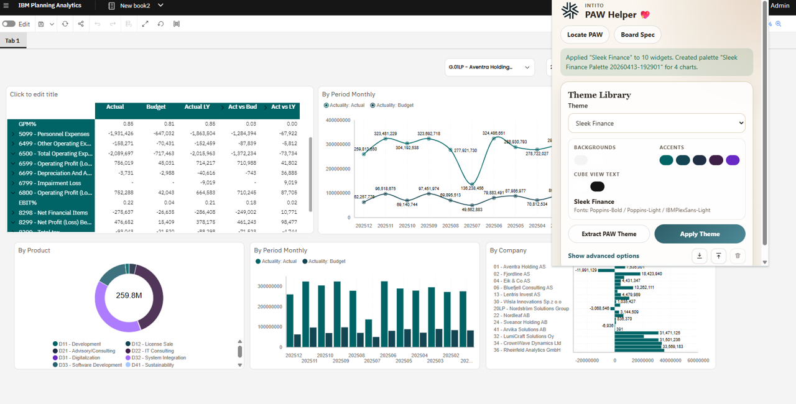
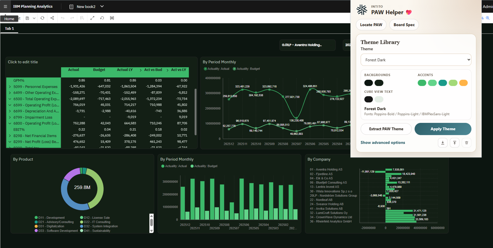

# PAW Helper

A Chrome extension for styling IBM Planning Analytics Workspace books: apply themes, edit colors and logos, extract reusable themes, and inspect or replace a book's JSON specification.

## Theme examples

The same PAW book can take on different styles using the **Theme** dropdown in the helper's **Theme Library**, followed by **Apply Theme**.

### Sleek Finance

A light canvas with teal headers and coordinated chart colors. The helper is open on the right: select the theme at the top of the card, edit its color swatches in the middle, and apply it using the button below the preview.



### Forest Dark

A dark green canvas with bright green headers and chart accents, applied to the same book.



These screenshots show an earlier build. Version 0.8.1 reuses stable palette names instead of creating timestamped names on each apply.

## Install

1. Download `paw-helper-0.8.1.zip` from [Releases](https://github.com/DavidPretorius/paw-helper/releases/latest).
2. Extract the ZIP to a permanent folder.
3. Open `chrome://extensions` in Chrome and enable **Developer mode**.
4. Click **Load unpacked** and select the extracted `paw-helper` folder containing `manifest.json`.
5. Open or refresh your PAW book, then open PAW Helper from Chrome's extensions menu.

Alternatively, clone this repository and load the `extension` folder. No build step is required. Keep the extracted folder: Chrome loads the extension from it.

## Use

- Choose a theme and review its colors and fonts.
- Select the styling options you want, then click **Apply Theme**.
- Review the book and save it normally in PAW.
- Use **Extract PAW Theme** to make a reusable theme, or generate one from an ordinary webpage.
- Use **Board Spec** to inspect, copy, or apply workbook JSON.

Work on a copy of your book when trying a new theme. Full board-spec replacement can overwrite book content.

A palette named `<Theme Name> Palette` is reused by name. Its saved colors are never updated, even when the theme's colors differ. A missing palette is created once under that stable name. Extracted themes can also preserve existing per-chart palette assignments when widget IDs match.

Selector bindings, selected members and interaction settings are preserved. Selectors are excluded from automatic row alignment and height equalization.

## Extract a theme from any other website

1. **Open a website in Chrome.** Go to the page whose colors and fonts you want to use. Open **PAW Helper** from the extensions menu (the puzzle-piece icon near the top-right of Chrome), or click its toolbar icon if you have pinned it.
2. **Extract the theme.** Near the top of the helper, find **Extract Theme From Web Page** and click **Extract Web Theme**. The helper samples the page's appearance and adds a saved theme to the **Theme Library** below. This is a starting point for a theme, rather than a copy of the website's layout.
3. **Modify the colors if you want.** In **Theme Library**, click a swatch under **Backgrounds**, **Accents**, or **Cube View Text**. In the **Edit Color** dialog, enter a HEX value or use the color picker, then click **Apply** inside the dialog.
4. **Save your edits.** Click the floppy-disk save icon in the small toolbar at the bottom-right of **Theme Library**. It appears when edits are available. Save before closing the helper or switching tabs so your changes are retained.
5. **Apply it to your PAW book.** Return to the PAW tab and reopen the helper. Choose your saved theme from the **Theme** dropdown in **Theme Library**. Click **Show advanced options** below the preview if you want to choose which settings are applied, then click **Apply Theme**. Review the result and save the book normally in PAW.

On a PAW page, **Extract PAW Theme** sits to the left of **Apply Theme**. That button extracts the current book's styling; **Extract Web Theme** is shown when the helper is opened on an ordinary website. Browser-internal pages such as `chrome://extensions` cannot be used for website extraction.

### Download, edit, and upload theme JSON

You can also save a theme as a `.json` file, modify it in a text editor, and upload it again.

| Action | Where to find it | What happens |
| --- | --- | --- |
| **Download theme** | Down-arrow icon in the small toolbar at the bottom-right of **Theme Library** | Downloads the selected theme as `<Theme Name>.json`, including current color edits. Chrome saves it to your configured download location, usually **Downloads**, or asks you where to save it. |
| **Edit the JSON** | Open the downloaded file in a text editor, such as VS Code | Change the theme's `name`, colors, fonts, or other settings. The `authoringPalette` block contains the primary/secondary backgrounds and ordered accent colors. Save as valid JSON. |
| **Upload theme** | Up-arrow icon beside the download icon | Opens a file picker. Select your edited `.json` file; it is added to **Theme Library** as a saved theme and selected automatically. |
| **Apply the uploaded theme** | **Apply Theme**, below the preview while on a PAW page | Applies the selected theme to the open book. |

On PAW pages, the icon toolbar is to the right of **Show advanced options**, below the **Extract PAW Theme** and **Apply Theme** buttons. On other websites, it sits directly below the theme preview. Hover over an icon to see its label; scroll within the popup if the bottom of the card is out of view.

Saved themes live in this browser's local extension storage. Use JSON download/upload to share them or move them to another browser or computer. If you want different chart colors from an already saved PAW palette, give the edited theme a new `name`: an existing same-name palette keeps its saved colors.

See [theme authoring and detailed behavior](docs/THEMES.md).

## Compatibility

This is a Manifest V3 Chrome extension using PAW's internal browser APIs, including `window.__getDashboardAPI()`. IBM can change these APIs between releases. It is an independent helper, not an IBM-supported product.

The regression suite uses simulated PAW/browser APIs. Live rendering on macOS has not been verified. Fonts must be available in the target environment for matching typography.

## Privacy and permissions

The extension requests `activeTab`, `scripting`, `storage`, and access to all websites. PAW can be hosted on different domains, and webpage theme extraction operates on arbitrary sites. Its content script is installed on matching pages.

Saved themes are stored in Chrome's local extension storage. Workbook actions use your existing PAW session; the helper does not request your PAW password. Custom palette creation writes an asset to PAW. The extension code contains no analytics or telemetry service.

Theme extraction reads page styles and may fetch a chosen logo URL. Remote logos are loaded from their hosts. Review extracted themes and workbook JSON before sharing them: they can include source URLs, branding, chart references, or workbook information.

## Development

No npm dependencies are required. Run the tests with Node.js 24:

```sh
node --test extension/tests/*.test.cjs
```

Build and verify a distributable ZIP with Python 3:

```sh
python scripts/package.py
```

The archive is written to `dist/` and excludes tests and development files.

When reporting a bug, include the helper version, Chrome/macOS or Windows version, PAW version, and steps to reproduce. Use sanitized examples; do not post real workbook data or credentials.

## License

No license is provided at this time.
